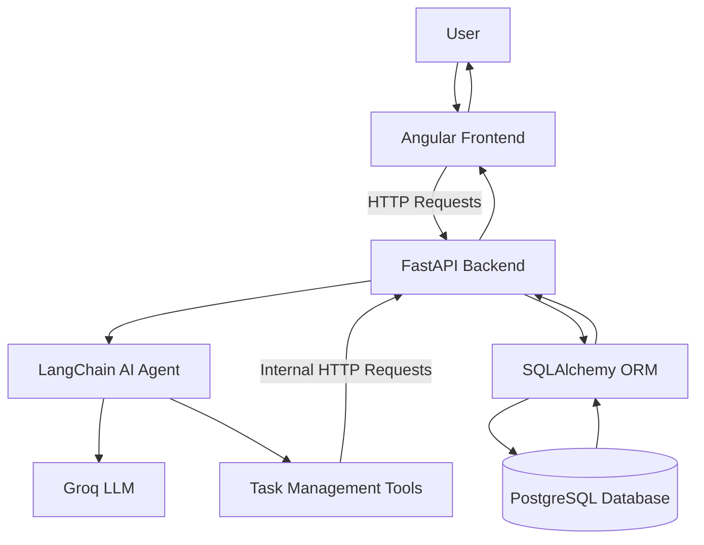
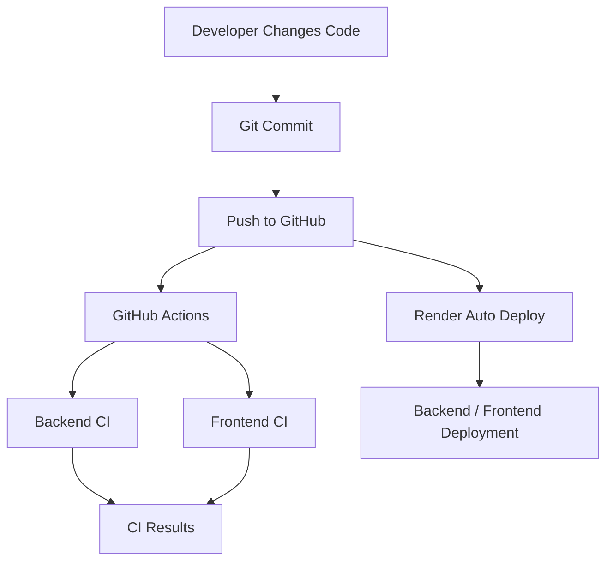

# 🤖 AI Task Agent

An AI-powered Task Management application built using **FastAPI, Angular, LangChain, Groq LLM, and PostgreSQL**. It allows users to manage tasks using natural language while providing traditional REST APIs for task operations.

The AI agent understands user instructions, selects the appropriate tools, communicates with the Task API, and performs task operations against the database.

## 🚀 Live Application

- **Frontend:** https://ai-task-agent-frontend-0h60.onrender.com/
- **Backend API:** https://ai-task-agent-urna.onrender.com
- **Swagger Documentation:** https://ai-task-agent-urna.onrender.com/docs

## ✨ Features

### 🤖 AI-Powered Task Assistant
- Interact with the application using natural language.
- Retrieve all tasks through conversational commands.
- Create tasks with titles, descriptions, due dates, and statuses.
- Update existing tasks.
- Delete tasks using their Task IDs.
- Uses LangChain tools to connect the AI agent with backend functionality.

### 📋 Task Management
- Create, retrieve, update, and delete tasks.
- Manage task statuses:
  - Pending
  - InProgress
  - Completed
- Store task descriptions and due dates.
- Persist task records in PostgreSQL.

### 🔧 Backend
- RESTful APIs built using FastAPI.
- SQLAlchemy for database connectivity and ORM.
- Centralized API communication through reusable functions.
- HTTP error handling and request timeouts.
- CORS configuration for frontend-backend communication.

### 🎨 Frontend
- Angular standalone components.
- Chat-based user interface.
- Integration with FastAPI endpoints.
- HTTP communication through Angular services.

### ☁️ Deployment & CI/CD
- Backend deployed on Render.
- Angular frontend deployed as a Render Static Site.
- PostgreSQL database hosted on Render.
- GitHub Actions for automated CI checks.
- Automatic deployment through Render when changes are pushed to GitHub.

## 🛠️ Technology Stack

| Category | Technologies |
|---|---|
| Frontend | Angular, TypeScript, HTML, CSS |
| Backend | Python, FastAPI |
| AI Framework | LangChain |
| LLM Provider | Groq |
| Database | PostgreSQL |
| ORM | SQLAlchemy |
| HTTP Client | Requests |
| API Documentation | Swagger / OpenAPI |
| Version Control | Git, GitHub |
| CI/CD | GitHub Actions |
| Cloud Hosting | Render |

## 🏗️ Application Architecture



### AI Agent Workflow

1. The user enters a natural language instruction in the Angular chat interface.
2. Angular sends the request to the FastAPI chat endpoint.
3. LangChain passes the user's question to the Groq-powered AI agent.
4. The agent identifies the appropriate task management tool.
5. The selected tool sends an HTTP request to the Task API.
6. FastAPI processes the request and communicates with PostgreSQL through SQLAlchemy.
7. The result is returned to the AI agent.
8. The agent generates a user-friendly response.
9. Angular displays the final response.

## 📁 Project Structure

```text
AI_Task_Agent/
│
├── Backend/
│   ├── main.py
│   ├── database.py
│   ├── models.py
│   ├── tools.py
│   ├── requirements.txt
│   └── ...
│
├── Frontend/
│   ├── src/
│   │   ├── app/
│   │   │   ├── components/
│   │   │   ├── services/
│   │   │   └── ...
│   │   └── environments/
│   ├── angular.json
│   ├── package.json
│   └── ...
│
├── .github/
│   └── workflows/
│       └── ci-cd.yml
│
├── .env
├── .gitignore
└── README.md
```

## 🗄️ Database Design

The application uses PostgreSQL to persist task information.

### Tasks Table

| Column | Description |
|---|---|
| TaskId | Unique task identifier |
| Title | Task title |
| Status | Current task status |
| CreatedAtUtc | Task creation timestamp |
| Description | Optional task description |
| DueDateUtc | Optional task due date |
| UpdatedAtUtc | Last updated timestamp |

SQLAlchemy models are used to map application objects to database records.

## 🔌 API Endpoints

Base URL:

```text
https://ai-task-agent-urna.onrender.com
```

| Method | Endpoint | Description |
|---|---|---|
| GET | `/api/tasks` | Retrieve all tasks |
| POST | `/api/tasks` | Create a task |
| PATCH | `/api/tasks/{task_id}` | Update a task |
| DELETE | `/api/tasks/{task_id}` | Delete a task |
| POST | `/api/chat` | Interact with the AI assistant |

Interactive API documentation:

`/docs`

## ⚙️ Local Development Setup

### Prerequisites

- Python 3.11+
- Node.js and npm
- Angular CLI
- Git
- PostgreSQL database
- Groq API key

### 1. Clone the Repository

```bash
git clone https://github.com/Prasanth-Pali/AI_Task_Agent.git

cd AI_Task_Agent
```

### 2. Backend Setup

Navigate to the project root and create a virtual environment:

```bash
python -m venv .venv
```

Activate it on Windows PowerShell:

```powershell
.venv\Scripts\Activate.ps1
```

Install backend dependencies:

```bash
pip install -r Backend/requirements.txt
```

### 3. Configure Environment Variables

Create a `.env` file in the project root:

```env
GROQ_API_KEY=your_groq_api_key
DATABASE_URL=your_postgresql_connection_string
```

Use your actual database connection string and API key.

**Important:** Never commit `.env` or expose API keys in GitHub.

### 4. Run the Backend

From the project root:

```bash
uvicorn Backend.main:app --reload
```

Backend:

```text
http://localhost:8000
```

Swagger documentation:

```text
http://localhost:8000/docs
```

### 5. Frontend Setup

Open another terminal:

```bash
cd Frontend
```

Install dependencies:

```bash
npm install
```

Run Angular:

```bash
ng serve
```

Frontend:

```text
http://localhost:4200
```

## ☁️ Deployment Architecture

The application is deployed using Render.

| Component | Hosting |
|---|---|
| Angular Frontend | Render Static Site |
| FastAPI Backend | Render Web Service |
| PostgreSQL Database | Render PostgreSQL |

### Backend Deployment

- Connect the GitHub repository to Render.
- Configure the backend service to use the project root.
- Install dependencies using `pip install -r Backend/requirements.txt`.
- Start the application using:

```bash
uvicorn Backend.main:app --host 0.0.0.0 --port $PORT
```

- Configure production environment variables in Render.
- Use the PostgreSQL Internal Database URL for the deployed backend.

### Frontend Deployment

- Create a Render Static Site.
- Select the same GitHub repository.
- Set the root directory to `Frontend`.
- Build command:

```bash
npm install && npm run build
```

- Publish directory:

```text
dist/frontend
```

- Configure the production Angular environment to point to the deployed backend API.

### Production API Communication

The AI agent's task tools communicate with the Task API running inside the same backend service.

The API base URL supports environment-based configuration and uses the Render-provided port in production, with localhost port 8000 as the local development fallback.

CORS is configured to allow the deployed Angular frontend origin.

## 🔄 CI/CD Pipeline

GitHub Actions automates basic application checks whenever changes are pushed to the `main` branch or a pull request is created.

### Backend CI
- Set up Python.
- Install backend dependencies.
- Compile Python modules to check syntax.

### Frontend CI
- Set up Node.js.
- Install npm dependencies.
- Run the Angular production build.

### Deployment Workflow



Render Auto-Deploy is configured to detect new commits pushed to the connected branch.

## 🔐 Security Considerations

- Store sensitive configuration in environment variables.
- Never commit API keys or database credentials.
- Restrict CORS to trusted frontend origins.
- Use HTTPS for production communication.
- Keep database credentials out of source code.

## 🎯 Learning Outcomes

This project demonstrates practical experience with:

- Building REST APIs using FastAPI.
- Developing AI agents using LangChain.
- Integrating LLMs through Groq.
- Implementing tool calling for real-world operations.
- Connecting Python applications to PostgreSQL using SQLAlchemy.
- Developing frontend applications using Angular.
- Integrating frontend and backend applications.
- Deploying full-stack applications on Render.
- Configuring GitHub Actions CI workflows.
- Implementing environment-based application configuration.

## 👨‍💻 Author

**Prasanth Pali**

GitHub: https://github.com/Prasanth-Pali

---

⭐ If you find this project useful, consider giving it a star!